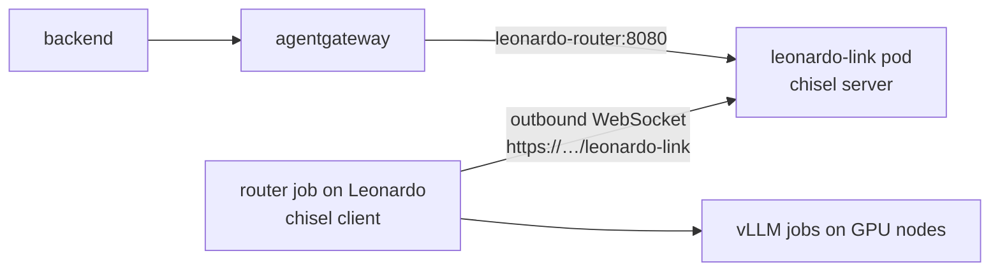

# Leonardo models in agentgateway (opt-in)

This component lets the app call open-weight models that run on CINECA's Leonardo through agentgateway,
under names like `qwen3-235b-a22b-fp8-leonardo`, with the same internal-key check and guardrail webhook as
every other model. It is **not enabled**: nothing changes in the cluster until the `components:` line in
step 2 is added. Leonardo's side is in [leonardo/](../../leonardo/README.md); the design and the
alternatives that were considered are in
[leonardo/docs/cluster-link.md](../../leonardo/docs/cluster-link.md).



Leonardo's GPU nodes cannot be reached from outside, so the connection is opened **from** Leonardo: the
router job dials out to a chisel server in this cluster over the existing public Ingress and opens one
reverse port (9000) inside that pod. agentgateway calls that port through the `leonardo-router` Service.
Nothing in the cluster logs in to Leonardo, and the chisel server accepts exactly one user, who may open
only that port.

## What enabling it changes

Rendered with `infrastructure/gke` (checked by `leonardo/tests/test_manifests.py` in CI):

| Object | Change |
| --- | --- |
| Deployment, Service `leonardo-link` | New: chisel 1.13.0 server (image pinned by digest), non-root, read-only root filesystem, no capabilities. One replica, `Recreate`: the reverse port exists only on the pod that holds the client's session. |
| Service `leonardo-router` | New: port 8080 → port 9000 of that pod. Cluster-internal only. |
| BackendConfig `leonardo-link` | New: 24 h backend timeout (the load balancer would otherwise cut the WebSocket after 30 s), health check on chisel's `/health`. |
| Ingress `frontend` | One more path, `/leonardo-link` → `leonardo-link:8080`, on the existing host and certificate. |
| Deployment `agentgateway` | Mounts the Secret `leonardo-router` at `/var/run/leonardo-router`. |
| ConfigMap `agentgateway-config` | Replaced by [agentgateway.yaml](agentgateway.yaml): `../base/agentgateway.yaml` plus one route per Leonardo model, generated by `leonardo/tools/render_agentgateway.py` (CI fails if it is stale). Exact model names win over the `"*"` route, so Gemini calls are unchanged. |

The same branch changes one line in `infrastructure/gke/agentgateway.yaml`: its `$patch: delete` for the
Google credentials mount now names `mountPath`, the merge key of `volumeMounts`. With `name` only,
kustomize also dropped the component's token mount, and agentgateway would not start. Without the
component, the rendered GKE manifests are byte-identical before and after this change.

## What was tested, and what was not

`leonardo/tests/cluster_link_poc/run.sh` deploys `infrastructure/base` with this component, unchanged, to a
local k3s cluster (with stand-ins for the auth and backend images), runs the Leonardo side on the same
machine with the real router code and chisel client, and checks:

- the router job opens the link, and `cli.py status` shows it as `connected`;
- agentgateway rejects a caller without the internal key (401); a chat completion and a streamed one reach
  the model through the link; the guardrail webhook blocks a request (403);
- the public link path serves no API (404 without the WebSocket handshake);
- after the chisel pod is deleted, the link comes back without anyone acting (6 to 48 s; see below), and
  the router's status shows the outage and the reconnect;
- with the router stopped, agentgateway answers 503 at once instead of hanging.

Not tested, because they need the real GKE and Leonardo: the GCE load balancer passing the WebSocket
through the Ingress (the BackendConfig timeout is set for it), the managed certificate seen by the chisel
client, and whether Leonardo's CPU queue may open an outbound HTTPS connection to the cluster at all. The
local recovery time depended on how long the client's TCP dial to a Service without a ready pod hung; behind
the load balancer, TCP connections are always accepted, and the client retries at least every 30 s.

## Enabling it

**0. Before anything else**: the organisers must approve the outbound connection from Leonardo (CINECA's
terms forbid working around security controls). This needs nothing from the cluster yet.

**1. Secrets.** Two Secrets in the namespace of the deployment, created by hand (the GitHub deployer has no
access to Secrets):

```bash
SERVER_KEY=$(docker run --rm jpillora/chisel:1.13.0 server --keygen -)
LINK_PASSWORD=$(openssl rand -hex 24)
kubectl create secret generic leonardo-link --from-literal=server.key="$SERVER_KEY" \
  --from-literal=users.json="{\"leonardo:$LINK_PASSWORD\": [\"^R:0.0.0.0:9000\$\"]}"
kubectl create secret generic leonardo-router --from-file=token=<router token file>
```

The router token comes from the Leonardo user whose router the app will use
(`./leonardo/cli.py router token`). Hand `leonardo:$LINK_PASSWORD` to that user over a private channel. Both
pods read their Secret at start: after changing one, `kubectl rollout restart deployment/leonardo-link
deployment/agentgateway`. Create the Secrets **before** step 2; agentgateway does not start without
`leonardo-router`.

**2. Enable the component.** Add to `infrastructure/gke/kustomization.yaml`:

```yaml
components:
  - ../leonardo
```

and add `leonardo-link` to the `rollout status` loop in `.github/workflows/deploy-gke.yml`. Deploy as usual.

**3. Verify from your machine.**

```bash
kubectl rollout status deployment/leonardo-link deployment/agentgateway
kubectl logs deploy/leonardo-link | grep Fingerprint      # hand this to the Leonardo user
curl -sS -m 5 -o /dev/null -w '%{http_code}\n' -H 'Connection: Upgrade' -H 'Upgrade: websocket' \
  -H 'Sec-WebSocket-Version: 13' -H 'Sec-WebSocket-Key: dGhlIHNhbXBsZSBub25jZQ==' \
  -H 'Sec-WebSocket-Protocol: chisel-v3' https://european-ai-hackathon-2026.codify.ch/leonardo-link
```

`101` (curl then times out, as expected) means the load balancer passes the WebSocket through to chisel.
`404` from the frontend, or `502`, means the path or the BackendConfig did not apply.

**4. Leonardo side** (the Leonardo user, see the leonardo README): set `cluster_link` in the team's
`inference-site.json` (`enabled`, `server` `https://european-ai-hackathon-2026.codify.ch/leonardo-link`,
the `fingerprint`), `cli.py install --link-client`, then `cli.py router up --restart --link-auth-file …`.
`cli.py status` shows `cluster link connected`, and `kubectl logs deploy/leonardo-link` shows
`R:9000=>…: Listening`.

**5. End to end**, from your machine, with the backend's internal key:

```bash
kubectl port-forward svc/agentgateway 13000:3000 &
KEY=$(kubectl get secret gateway-internal -o jsonpath='{.data.key}' | base64 -d)
curl -sS http://127.0.0.1:13000/v1/chat/completions -H "Authorization: Bearer $KEY" \
  -H 'Content-Type: application/json' \
  -d '{"model":"qwen3-0.6b-leonardo","messages":[{"role":"user","content":"Hi"}],"chat_template_kwargs":{"enable_thinking":false}}'
```

A `503` means the link is down or no router is running; a `404 model_not_found` from the router means
the link works but that model's server is not running.

## Operating notes

- Only the models of **one** Leonardo user are reachable: their router routes only their own servers, and
  only one router can hold port 9000. A second client with the same password stays `retrying`, with
  `server: Server cannot listen on R:9000=>…` in its status.
- The router job renews itself every 4 hours; expect a gap of a few seconds at each handover, during which
  agentgateway answers 503.
- **Rollback**: remove the `components:` lines and deploy, then delete the two Secrets. To cut the link at
  once without a deploy: `kubectl scale deployment/leonardo-link --replicas=0`.
- **Revoking access**: new `leonardo-link` Secret (new password, optionally a new server key, which changes
  the fingerprint), then restart `leonardo-link`.
