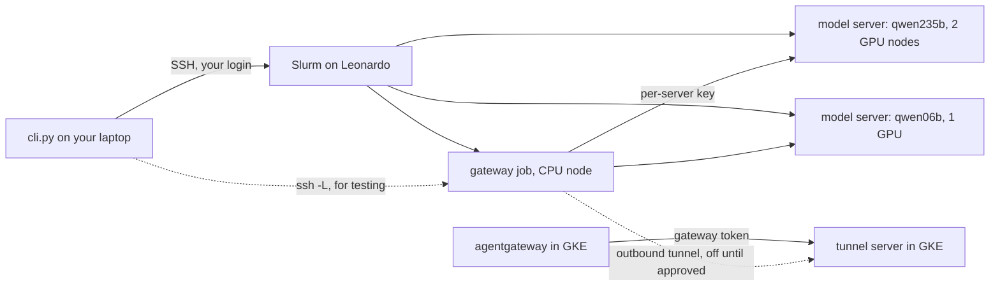

# Leonardo inference

## What is this for?

The team's app normally sends every model call through agentgateway to Vertex AI (Gemini). This folder
lets the team run **open-weight models on CINECA's Leonardo supercomputer** instead and use them with the
same OpenAI-compatible API: large models for the main work, and small one-GPU models such as moderation
classifiers.

| Profile | Model | Served as | Hardware | Cold start | Status |
| --- | --- | --- | --- | --- | --- |
| `qwen235b` | Qwen3-235B-A22B-FP8 | `qwen3-235b-a22b-fp8-leonardo` | 2 nodes, 8 A100 | 7 min | GPU-validated |
| `glm53` | GLM-5.3-Flash | `glm-5.3-flash-leonardo` | 2 nodes, 8 A100 | 13 min | GPU-validated |
| `deepseek41` | DeepSeek-V4.1-Flash-1017 | `deepseek-v4.1-flash-1017-leonardo` | 2 nodes, 8 A100 | 26 min | GPU-validated |
| `qwen06b` | Qwen3-0.6B | `qwen3-0.6b-leonardo` | 1 A100 | | not yet run |

The large models run with a 2,048-token context and 4 concurrent sequences (DeepSeek: 2) for up to two
hours per job. "GPU-validated" refers to an earlier version of the launcher; see
[Validation status](#validation-status).

The serving framework was built by Junghwa ([@Jules0315](https://github.com/Jules0315)) on top of the team's
starter kit, and copied from [Jules0315/Guardrails-vllm](https://github.com/Jules0315/Guardrails-vllm) at
commit `298432c`.

## How does it work?

Leonardo is a Slurm cluster: you get GPUs by submitting jobs, jobs end at a time limit, and GPU nodes have
no internet. So there are three parts:

1. **Install, once per team.** Container images (runtimes) and model weights are downloaded into the team
   folder under `$WORK` by CPU-only jobs, which do have internet.
2. **Model servers.** Each model is a Slurm job that runs vLLM in a Singularity container. A server gets
   a fresh API key per run and announces itself only after a set of API checks has passed.
3. **Gateway.** A small CPU job that is the single entry point to all of your running servers. It routes
   each request by its `model` field and swaps your gateway token for that server's own key.

You drive all three from your laptop with `cli.py`, which logs in with your own CINECA account.
Optionally, the gateway also connects **out** to the team's GKE cluster, so the backend reaches the models
through agentgateway without anyone logging in to Leonardo from Kubernetes:



[docs/how-it-works.md](docs/how-it-works.md) explains every step in detail.

## Installation

### What you need

- Your own CINECA login on Leonardo (usernames are personal and must not be shared) and access to the
  project allocation (`SBATCH_ACCOUNT`).
- The team folder on Leonardo, `$WORK/<team folder>`, called `$BASE` below. The docs use `team_vllm`, the
  public placeholder; ask Junghwa for the real name.
- On your laptop: an SSH client and Python 3.7 or newer. Nothing else to install; `cli.py` uploads the
  code to Leonardo itself.

### Where things live

| What | Where | Who creates it |
| --- | --- | --- |
| Runtimes, model weights, site config, team registry | `$BASE` on Leonardo, shared by the team | the install steps below, once |
| Uploaded code, gateway token, gateway state | `~/.leonardo-inference/` on Leonardo, private | `cli.py` |
| One directory per server run, with its key | `~/<profile>-run-<random>/` on Leonardo, private | `cli.py up` |
| Tunnel server and model routes | `infrastructure/leonardo/` in GKE | optional, see below |

### Set up the team folder (once)

The team's installation of the backport runtime and the three large models already exists. Two things
are new and have to be added before the first `qwen06b` run: the stock vLLM runtime and the small model.
On a Leonardo login node, in a clone of this repository, with `SBATCH_ACCOUNT` and `BASE` set:

```bash
cd leonardo/install
sbatch 01_pull_runtime.sbatch vllm-0.31.0       # container image -> $BASE/staging/vllm-0.31.0
sbatch 02_install_overlay.sbatch vllm-0.31.0    # after 01: extra Python packages (none for stock vLLM)
python3 register_runtime.py --id vllm-0.31.0 --sif "$BASE/staging/vllm-0.31.0/image.sif" \
  --overlay "$BASE/staging/vllm-0.31.0/python-overlay" --destination "$BASE/runtimes/vllm/0.31.0"
sbatch 03_download_checkpoint.sbatch qwen06b    # prints PIN_REVISION; put it into serve/profiles/qwen06b.json
```

Then add the new `runtime_paths` and `checkpoints` entries and the `"endpoints"` and `"gateway"`
settings from [serve/site.example.json](serve/site.example.json) to `$BASE/inference-site.json`. Create
`$BASE/users/` if it does not exist.

A completely new team folder repeats the same steps for the runtime `vllm-backport-sm80-0.13.1`
(destination `runtimes/vllm-backport-sm80/0.13.1`) and the profiles `qwen235b`, `glm53` and `deepseek41`,
and starts the site file from `site.example.json`. All install jobs run on the CPU-only `lrd_all_serial`
queue, which has internet. These scripts are generalised from the original preparation jobs and have
not been run in this exact form yet.

### Optional: connect the GKE cluster

Prepared, but **off until the organisers approve** the outbound connection, because the terms forbid
working around security controls. The gateway connects out with [chisel](https://github.com/jpillora/chisel)
to `https://european-ai-hackathon-2026.codify.ch/leonardo-tunnel` and may open exactly one port there.
First check that the gateway's queue can reach GPU nodes and the internet (see
[Troubleshooting](#troubleshooting)). Then:

1. Create the two secrets in GKE:

   ```bash
   SERVER_KEY=$(docker run --rm jpillora/chisel:1.13.0 server --keygen -)   # or the chisel binary
   TUNNEL_PASSWORD=$(openssl rand -hex 24)
   kubectl create secret generic leonardo-tunnel --from-literal=server.key="$SERVER_KEY" \
     --from-literal=users.json="{\"leonardo:$TUNNEL_PASSWORD\": [\"^R:0.0.0.0:9000\$\"]}"
   ./cli.py gateway token | kubectl create secret generic leonardo-gateway --from-file=token=/dev/stdin
   ```

2. Add `components: [../leonardo]` to `infrastructure/gke/kustomization.yaml` and deploy. Read the server's
   fingerprint with `kubectl logs deploy/leonardo-tunnel | grep Fingerprint`.
3. In `$BASE/inference-site.json`, under `gateway`, set `"outbound_tunnel": true`, `"tunnel_server"`, the
   `"tunnel_fingerprint"`, and `"tunnel_proxy"` if the route needs the hackathon proxy.
4. Install the tunnel client on Leonardo (`cd leonardo/install && sbatch 04_install_chisel.sbatch`), then
   from your laptop:

   ```bash
   printf 'leonardo:%s\n' "$TUNNEL_PASSWORD" > /tmp/tunnel_auth
   ./cli.py gateway up --restart --tunnel-auth-file /tmp/tunnel_auth && rm /tmp/tunnel_auth
   ```

The backend then uses the "Served as" names from the table above as model names in its agentgateway calls.

## Usage

### Configure the CLI

```bash
cd leonardo
export LEONARDO_USER=YOUR_LOGIN LEONARDO_BASE='$WORK/team_vllm'   # single quotes: expanded on Leonardo
```

The first command asks for your CINECA authentication; later commands reuse that SSH connection for 30
minutes.

### Start, watch and stop model servers

```bash
./cli.py up qwen235b                                       # prepare + submit; prints the job id
./cli.py up qwen06b --qos boost_qos_dbg --time 00:30:00    # short test on the debug queue
./cli.py status                                            # your servers, your gateway, the team registry
./cli.py down qwen235b                                     # by profile, served name or job id
```

A server shows `READY` in `status` once its checks have passed. Servers stop at their time limit (2 h on
the default `boost_qos_lprod`, 30 min on `boost_qos_dbg`); run `up` again to replace one. Coordinate with
the team: one large server at a time. Only one server per model name can run in the team at once; a second
one stops within seconds.

### Call the models

Through your gateway, from your laptop:

```bash
./cli.py gateway up --hours 12                             # keeps itself alive for 12 hours
./cli.py gateway token > ~/.config/leonardo-gateway-token  # your bearer token
./cli.py tunnel                                            # keep open: http://127.0.0.1:18000/v1
```

```bash
TOKEN=$(cat ~/.config/leonardo-gateway-token)
curl http://127.0.0.1:18000/v1/models -H "Authorization: Bearer $TOKEN"
curl http://127.0.0.1:18000/v1/chat/completions -H "Authorization: Bearer $TOKEN" -H 'Content-Type: application/json' \
  -d '{"model":"qwen3-235b-a22b-fp8-leonardo","messages":[{"role":"user","content":"Hi"}],
       "chat_template_kwargs":{"enable_thinking":false}}'
```

Any OpenAI client works with base URL `http://127.0.0.1:18000/v1` and the token as API key. The gateway
only sees servers started with the same login as the gateway. Expect a short gap every four hours, when
one gateway job hands over to the next.

From the cluster, once connected, the backend calls agentgateway as usual with a Leonardo model name.

To reach one server directly without the gateway, use `serve/client.py` with that server's
`endpoint.json` and key: `python3 serve/client.py --help`.

### Without the CLI

`cli.py` runs `serve/inference.py` on a login node; you can do the same by hand:

```bash
RUN_DIR=$(bash leonardo/serve/prepare_run.sh qwen235b --base "$WORK/team_vllm") && cd "$RUN_DIR"
bash submit_server.sh             # --dry-run shows the sbatch command; --qos/--time/--reservation work too
tail -f *-common-*.out            # wait for INFERENCE_READY
cat .runtime/endpoint.json        # node, port, model, expected end
scancel "$(cat .runtime/job_id)"
```

`python3 leonardo/serve/inference.py --help` lists all commands (`up`, `status`, `down`, `gateway-up`, …).

### Troubleshooting

- The job log is `<profile>-common-<job id>.out` in the run directory `~/<profile>-run-*/` on Leonardo;
  the gateway's is in `~/.leonardo-inference/gateway/`.
- A server that fails its checks never shows `READY`. Its check results are in `evidence/` in the run
  directory.
- `diagnostics/` has three jobs, submitted from that folder on Leonardo:

  ```bash
  sbatch probe.sbatch                                     # GPU node: interfaces, InfiniBand, GPU; serves a test page
  TARGET=lrdnXXXX:PORT PROBE_PROXY=http://... sbatch reach.sbatch   # CPU queue: reach GPU nodes? internet?
  BASE=$WORK/team_vllm RUNTIME=vllm-0.31.0 sbatch nccl_check.sbatch # 2 nodes: NCCL over InfiniBand?
  ```

## Further information and project structure

```text
cli.py        admin CLI for your laptop
serve/        everything that runs on Leonardo: profiles/, catalog.json (runtimes), Slurm jobs,
              readiness checks (test_endpoint.py), registry.py, gateway.py, client.py
install/      one-time setup of runtimes, model weights and the tunnel client in $BASE
diagnostics/  node probe, reachability check, NCCL bandwidth check
validation/   evidence from the GPU runs and the hashes of the code that passed them
docs/         how-it-works.md, history.md
tools/        manifest and agentgateway config generators, repository check
tests/        local tests with simulated Slurm, containers, SSH and HTTP
../infrastructure/leonardo/   opt-in Kubernetes component: tunnel server, Service, agentgateway routes
```

- [docs/how-it-works.md](docs/how-it-works.md): the run step by step, the gateway, the registry, ports,
  profile rules, the release manifest and the shared folder layout. Read it before changing `serve/`.
- [docs/history.md](docs/history.md): how the models were brought up, which compatibility problems were
  solved, and what was consolidated from Junghwa's repository and the starter kit.
- [Kubernetes component](../infrastructure/leonardo/kustomization.yaml).

### Validation status

[validation/validated_code.json](validation/validated_code.json) records the exact `serve/` files that ran
on GPUs with all checks passing, one operator account per model. Since then, `inference.py`, `lifecycle.py`,
`node.py` and `test_endpoint.py` have changed and the gateway, registry and `qwen06b` were added;
`python3 tools/check_repository.py` lists all of them. The model profiles and the container command are
unchanged. Other accounts, sustained load and unattended operation are untested. The gateway and tunnel
chain was tested end to end on a workstation with a stand-in model server, not yet on Leonardo or GKE.

## Contributing and extending

Changes go into this folder through pull requests to the Codify repository. CI runs the local checks;
run them before pushing:

```bash
cd leonardo
python3 tools/check_repository.py      # syntax, manifest, agentgateway config, links, drift from validated code
python3 -m unittest discover -s tests  # simulated Slurm, containers, SSH and HTTP
```

Conventions:

- Everything in `serve/`, `tools/` and `install/` uses only the standard library and Python 3.6 syntax,
  because the login nodes run Python 3.6. CI checks this with `vermin`.
- Never put keys or tokens into `$BASE`: other teams on the same project account may be able to read it.
- After any change in `serve/`, run `python3 tools/update_manifest.py`. `prepare` refuses code that does
  not match the manifest.
- A change to `serve/` is only trusted after a run on GPUs: run each affected profile once on the debug
  queue and record the result and the new hashes in `validation/`.

### Add a model

1. Copy a profile in `serve/profiles/`; `qwen06b.json` is the template for one-GPU models. Set `model_id`,
   `revision`, `checkpoint`, `served_model`, resources and parallelism, and the vLLM `engine_args`.
   [The profile rules](docs/how-it-works.md#profiles) are checked when a run is prepared.
2. Pick the checks the server must pass before it is announced, with `"checks"`:

   | `checks` | Runs | For |
   | --- | --- | --- |
   | `chat_tools` (default) | 401, catalog, arithmetic, English, SSE, forced tool call, 4 concurrent | chat models |
   | `chat` | the same without the tool call | chat models without a tool parser |
   | `minimal` | 401, catalog, any completion | generative guard models such as Llama Guard |
   | `classify` | 401, catalog, `/classify` returns a label | `--runner pooling` classifiers |

   agentgateway routes chat-style APIs, so classifiers are called through the gateway directly.
3. Download it: `sbatch install/03_download_checkpoint.sbatch <profile>`, and add its checkpoint to
   `$BASE/inference-site.json`.
4. Run `python3 tools/update_manifest.py` and `python3 tools/render_agentgateway.py` (the latter adds the
   model's route to the Kubernetes component), then a debug-queue run.

### Add a runtime

Add an entry to `serve/catalog.json`: the image pinned by digest, any extra pinned wheels for its Python
overlay, the overlay files that must exist and the modules to import in `cpu-check`. Install it with
`install/01`, `02` and `register_runtime.py` as above. `diagnostics/Dockerfile.ib` is a starting point
if NCCL falls back to TCP because an image lacks InfiniBand libraries.
