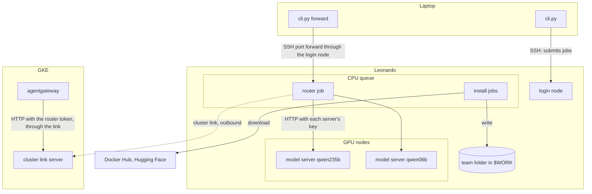

# Leonardo inference

## What is this for?

The team's app sends every model call through agentgateway, which today forwards it to Vertex AI (Gemini).
This folder lets a team run **open-weight models on CINECA's Leonardo supercomputer** and use them through
the same OpenAI-compatible API: large models for the main work, and small one-GPU models such as
moderation classifiers. It is a reusable template: everything below starts from an empty team folder.

| Profile | Model | Served as | Hardware | Cold start | Status |
| --- | --- | --- | --- | --- | --- |
| `qwen235b` | Qwen3-235B-A22B-FP8 | `qwen3-235b-a22b-fp8-leonardo` | 2 nodes, 8 A100 | 7 min | GPU-validated |
| `glm53` | GLM-5.3-Flash | `glm-5.3-flash-leonardo` | 2 nodes, 8 A100 | 13 min | GPU-validated |
| `deepseek41` | DeepSeek-V4.1-Flash-1017 | `deepseek-v4.1-flash-1017-leonardo` | 2 nodes, 8 A100 | 26 min | GPU-validated |
| `qwen06b` | Qwen3-0.6B | `qwen3-0.6b-leonardo` | 1 A100 | | not yet run |

The large models run with a 2,048-token context and 4 concurrent sequences (DeepSeek: 2) for up to two
hours per job. "GPU-validated" refers to an earlier version of the launcher; see
[Validation status](#validation-status).

The serving framework was built by Junghwa Lee ([@Jules0315](https://github.com/Jules0315)) on top of the
team's starter kit, and copied from [Jules0315/Guardrails-vllm](https://github.com/Jules0315/Guardrails-vllm)
at commit `298432c`.

## How does it work?

Leonardo is a Slurm cluster: you get GPUs by submitting jobs, every job ends at a time limit, GPU nodes
have no internet, and only the CPU queue `lrd_all_serial` does. Everything is driven from your laptop
with `leonardo/cli.py`, which logs in to Leonardo with your own account over SSH and runs the matching
script there. The parts:

| Part | What it is | Runs where |
| --- | --- | --- |
| **Team folder** (`$BASE`) | A folder in `$WORK` with the container images (*runtimes*), model weights (*checkpoints*) and settings, shared with your teammates. | Leonardo's shared file system |
| **Install jobs** | Download runtimes and checkpoints into the team folder. | CPU queue (has internet) |
| **Model server** | One vLLM instance in a Singularity container. It gets a fresh API key per run and is announced in the team folder's registry only after a set of API checks has passed. | GPU nodes, as a Slurm job |
| **Router** | One entry point for all of *your* running model servers: it routes each request by its `model` field and swaps your router token for that server's key. Not to be confused with agentgateway, which is the app's gateway in Kubernetes. | CPU queue, as a Slurm job that renews itself |
| **SSH port forward** (`cli.py forward`) | Makes the router reachable on your laptop: `ssh -L` from the laptop through the login node to the router's node and port. For testing and personal use. | Your laptop |
| **Cluster link** (optional) | Lets agentgateway in GKE reach the router. The router job connects **out** to a [chisel](https://github.com/jpillora/chisel) server in the cluster, so nobody logs in to Leonardo from Kubernetes. Off until the organisers approve it. | Router job and GKE |

In the diagram, an arrow points from the side that opens the connection to the side that accepts it:



### Where things live

| What | Where | Visible to |
| --- | --- | --- |
| Settings | `$BASE/inference-site.json` | everyone the folder is shared with |
| Runtimes and checkpoints | `$BASE/runtimes/<runtime id>/`, `$BASE/checkpoints/<checkpoint>/` | shared |
| Registry of ready servers (addresses only, never keys) | `$BASE/endpoints/` | shared |
| Install logs, cluster link client | `$BASE/logs/`, `$BASE/tools/` | shared |
| Your runs (code copy, API key, logs, check results), caches, router, diagnostic logs | `$BASE/users/<login>/` | only you (mode 700) |
| Code uploaded by `cli.py` | `~/.leonardo-inference/releases/<hash>/` on Leonardo | only you |

Your personal folder is private because it holds API keys and the router token; the rest of the team
folder is shared with whoever you name. [docs/how-it-works.md](docs/how-it-works.md) explains each step in
detail.

## Installation

### What you need

- **On your laptop:** an SSH client and Python 3.7 or newer. No packages, no virtual environment: the CLI
  and everything it runs on Leonardo use only the Python standard library.
- **On Leonardo:** your own CINECA login (logins are personal and must not be shared), membership in the
  project allocation (the Slurm *account*, e.g. `EUHPC_D30_031`), and a place for the team folder in
  that project's `$WORK`. Ask your mentor or admin for the account name and where the team folder
  should go. Nothing needs to be installed there; the CLI uses the system `python3`, Slurm and Singularity.

### Set up the team folder

All commands in this README run from the repository root on your laptop. Configure the CLI once per
shell (or put it in `.envrc`):

```bash
export LEONARDO_USER=<your login>
export LEONARDO_BASE='$WORK/<team folder>'   # single quotes: $WORK is expanded on Leonardo
```

Then, once per team:

```bash
./leonardo/cli.py init --account <project account>   # creates the folder and inference-site.json
./leonardo/cli.py share <login> <login> ...         # give teammates access (POSIX ACLs per login)
./leonardo/cli.py install qwen06b                   # runtime + weights for a profile; CPU-queue jobs
./leonardo/cli.py status                            # shows installed runtimes/checkpoints and running installs
```

`install` accepts several profiles (`install qwen06b qwen235b`) and skips what is already there. The
runtime job pulls the image and registers it; the weights job waits for it. Expect minutes for `qwen06b`
and hours for the large models (several hundred GB). A profile without a pinned model `revision` downloads
the current one and prints `PIN_REVISION <sha>` in its log; put that into the profile. For gated models
on Hugging Face, put `export HF_TOKEN=...` into your `~/.bashrc` on Leonardo before installing.

`share` can be repeated whenever someone joins, and `share --revoke <login>` takes access away. Your
teammates then set `LEONARDO_BASE` to the same folder and can use every command below; each of them gets
their own personal folder in `users/`.

### Optional: connect the GKE cluster

Prepared, but **off until the organisers approve** the outbound connection, because the terms forbid
working around security controls. First find out what the router's CPU queue can reach (see
[Troubleshooting](#troubleshooting)): GPU-node ports, and the internet directly or through the hackathon
proxy. Then:

1. Create two secrets in GKE: the chisel server's key and the one user it accepts (which may open only
   port 9000), and your router token.

   ```bash
   SERVER_KEY=$(docker run --rm jpillora/chisel:1.13.0 server --keygen -)
   LINK_PASSWORD=$(openssl rand -hex 24)
   kubectl create secret generic leonardo-link --from-literal=server.key="$SERVER_KEY" \
     --from-literal=users.json="{\"leonardo:$LINK_PASSWORD\": [\"^R:0.0.0.0:9000\$\"]}"
   ./leonardo/cli.py router token | kubectl create secret generic leonardo-router --from-file=token=/dev/stdin
   ```

2. Add `components: [../leonardo]` to `infrastructure/gke/kustomization.yaml` and deploy. This adds the
   chisel server under `https://european-ai-hackathon-2026.codify.ch/leonardo-link`, the `leonardo-router`
   Service and one agentgateway route per model. Read the server's fingerprint with
   `kubectl logs deploy/leonardo-link | grep Fingerprint`.
3. In `$BASE/inference-site.json`, set `cluster_link.enabled` to `true`, `server` to that URL,
   `fingerprint`, and `proxy` if the route needs the hackathon proxy.
4. Install the chisel client and restart your router with the link password:

   ```bash
   ./leonardo/cli.py install --link-client
   printf 'leonardo:%s\n' "$LINK_PASSWORD" > /tmp/link_auth
   ./leonardo/cli.py router up --restart --link-auth-file /tmp/link_auth && rm /tmp/link_auth
   ```

The backend then uses the "Served as" names from the table above as model names in its agentgateway calls.

## Usage

### Commands

`./leonardo/cli.py --help` lists the commands; `./leonardo/cli.py <command> --help` shows each one's
options and the files it runs on Leonardo. Every command runs `leonardo/serve/team.py <command>` there:

| Command | Parameters | What it does | Files it runs on Leonardo |
| --- | --- | --- | --- |
| `init` | `--account`, optional `--partition`, `--qos`, `--cpu-partition`, `--force` | Create the team folder and settings | `serve/team.py`, template `serve/site.example.json` |
| `share` | `LOGIN...`, `--revoke` | Grant or remove teammates' access | `serve/team.py` (`setfacl`) |
| `install` | `PROFILE...`, `--link-client` | Download runtimes, weights, chisel client | `install/runtime.sbatch` (with `install/register_runtime.py`), `install/checkpoint.sbatch`, `install/link_client.sbatch` |
| `up` | `PROFILE`, `--qos`, `--time`, `--reservation` | Start a model server | `serve/inference.py` (prepare, submit) → `serve/serve_model.sbatch` → `serve/node.py` (vLLM) and `serve/lifecycle.py` (checks in `serve/test_endpoint.py`, registry in `serve/registry.py`) |
| `status` | | Installs, your servers and router, team registry | `serve/team.py` |
| `logs` | `TARGET` (job id, profile, served name or `router`), `--lines`, `--follow` | Show a job's log | `serve/team.py` (`tail`) |
| `down` | `TARGET` (profile, served name, job id or `router`) | Stop servers or the router | `serve/team.py` (`scancel`) |
| `router` | `up` / `down` / `token`, `--hours`, `--restart`, `--token-file`, `--link-auth-file` | Manage your router | `serve/router.py` → `serve/router.sbatch` → `serve/router.py serve` |
| `forward` | `--local-port` (default 18000) | SSH port forward to your router | only `ssh -L` on the laptop |
| `diagnose` | `probe` / `reach` / `nccl`, `--target`, `--proxy`, `--link-url`, `--runtime` | Submit a check job | `diagnostics/probe.sbatch`, `reach.sbatch`, `nccl_check.sbatch` |
| `sync` | | Only upload the code | nothing |

The first command asks for your CINECA authentication; later commands reuse that SSH connection for 30
minutes. Each command uploads the code from your checkout if Leonardo does not have that exact version yet.

### Start and stop model servers

```bash
./leonardo/cli.py up qwen06b --qos boost_qos_dbg --time 00:30:00   # a quick test on the debug queue
./leonardo/cli.py up qwen235b                                      # the default queue: up to 2 hours
./leonardo/cli.py status                                           # wait for READY
./leonardo/cli.py logs qwen235b --follow                           # the server's job log
./leonardo/cli.py down qwen235b
```

A server shows `READY` once vLLM is up and its API checks have passed; until then it is `starting`. It
stops at its time limit (2 h on the default QoS `boost_qos_lprod`, 30 min on `boost_qos_dbg`); run `up`
again to replace it. Only one server per model name can run in a team folder at a time; a second one stops
within seconds. Coordinate large servers with the team: each takes two full nodes.

### Call the models

Start your router and forward a laptop port to it:

```bash
./leonardo/cli.py router up --hours 12                              # renews itself every 4 hours
./leonardo/cli.py router token > ~/.config/leonardo-router-token   # your bearer token
./leonardo/cli.py forward                                          # keep this running
```

In a second terminal:

```bash
TOKEN=$(cat ~/.config/leonardo-router-token)
curl http://127.0.0.1:18000/v1/models -H "Authorization: Bearer $TOKEN"
curl http://127.0.0.1:18000/v1/chat/completions -H "Authorization: Bearer $TOKEN" -H 'Content-Type: application/json' \
  -d '{"model":"qwen3-0.6b-leonardo","messages":[{"role":"user","content":"Hi"}],
       "chat_template_kwargs":{"enable_thinking":false}}'
```

Any OpenAI client works with base URL `http://127.0.0.1:18000/v1` and the token as API key. The router
reaches only servers started with your login. Expect a short gap every four hours, when one router job
hands over to the next. With the cluster link enabled, the app calls the same model names through
agentgateway instead.

### Without the CLI

On a login node, in a clone of the repository, `leonardo/serve/team.py <command> --base '$WORK/<team folder>'`
takes the same commands, and `leonardo/serve/inference.py` prepares and submits a single run by hand
(`--help` on both). `leonardo/serve/client.py` talks to one server directly with its own key.

### Troubleshooting

- `./leonardo/cli.py logs <job id>` shows any job's log: servers, router, installs and diagnostics. A
  server that fails its API checks never becomes `READY`; its check results are in
  `$BASE/users/<login>/runs/<profile>-*/evidence/`.
- `./leonardo/cli.py diagnose probe` starts a GPU job that prints the node's network, InfiniBand and GPU
  setup and serves a test page for 15 minutes. Its log names `lrdnXXXX:PORT`.
- `./leonardo/cli.py diagnose reach --target lrdnXXXX:PORT [--proxy http://...] [--link-url https://.../leonardo-link]`
  checks from the router's CPU queue whether it reaches that GPU node, the internet, and the cluster link
  server. A router that answers `502 upstream_unreachable` means the first one failed.
- `./leonardo/cli.py diagnose nccl` checks NCCL bandwidth over InfiniBand between two GPU nodes.

## Further information and project structure

```text
leonardo/
  cli.py          the laptop CLI
  serve/          everything that runs on Leonardo:
    team.py         the commands cli.py calls (init, share, install, up, status, logs, down, router, diagnose)
    inference.py    prepare and submit one model server run; profile rules and preflight checks
    serve_model.sbatch, node.py, lifecycle.py, test_endpoint.py   the model server job
    router.py, router.sbatch      the router job
    registry.py     the team registry in $BASE/endpoints
    profiles/       one JSON file per model
    catalog.json    the runtimes (container images, pinned extra packages) and the chisel client
    site.example.json   template for $BASE/inference-site.json
    client.py       direct client for one server
  install/        install job scripts (runtime, checkpoint, link client)
  diagnostics/    check job scripts (probe, reach, NCCL)
  validation/     evidence from GPU runs, hashes of the code that passed them
  docs/           how-it-works.md, history.md
  tools/          generators and the repository check
  tests/          local tests with simulated Slurm, containers, SSH and HTTP
infrastructure/leonardo/   opt-in Kubernetes component for the cluster link
```

- [docs/how-it-works.md](docs/how-it-works.md): a server run step by step, the router, the registry,
  ports, profile rules and the release manifest. Read it before changing `serve/`.
- [docs/history.md](docs/history.md): how the models were brought up, which compatibility problems were
  solved, and what was consolidated from Junghwa's repository and the starter kit.
- [The Kubernetes component](../infrastructure/leonardo/kustomization.yaml).

### Validation status

[validation/validated_code.json](validation/validated_code.json) records the exact `serve/` files that
passed real GPU runs (one operator account per model). Since then, `inference.py`, `lifecycle.py`,
`node.py` and `test_endpoint.py` have changed, and the CLI commands, router, registry and `qwen06b` were
added; `python3 leonardo/tools/check_repository.py` lists all of them. The model profiles and the
container command are unchanged. The router and cluster link were tested end to end on a workstation with
a stand-in model server; nothing new has run on Leonardo or GKE yet, and the install scripts have not been
run in their current form. Other accounts, sustained load and unattended operation are untested.

## Contributing and extending

Changes go into `leonardo/` through pull requests to the Codify repository. CI runs these checks; run them
before pushing:

```bash
python3 leonardo/tools/check_repository.py      # syntax, manifest, agentgateway routes, links, drift
python3 -m unittest discover -s leonardo/tests  # simulated Slurm, containers, SSH and HTTP
```

Conventions:

- Code that runs on Leonardo (`serve/`, `install/`, `tools/`) uses only the standard library and Python
  3.6 syntax, because the login nodes run Python 3.6; CI checks this with `vermin`. `cli.py` needs 3.7.
- Never write keys or tokens outside `$BASE/users/<login>/`.
- After any change in `serve/`, run `python3 leonardo/tools/update_manifest.py`; Leonardo refuses code
  that does not match the manifest.
- A change to `serve/` is trusted only after a GPU run: run each affected profile once with
  `--qos boost_qos_dbg` and record the result and the new hashes in `validation/`.

### Add a model

1. Copy a profile in `leonardo/serve/profiles/` (`qwen06b.json` for one GPU, `qwen235b.json` for two
   nodes). Set `model_id`, `revision`, `checkpoint`, `served_model`, resources, parallelism and the vLLM
   `engine_args`. [The profile rules](docs/how-it-works.md#profiles) are checked before each run.
2. Pick the checks a server must pass before it is announced, with `"checks"`:

   | `checks` | Runs | For |
   | --- | --- | --- |
   | `chat_tools` (default) | 401, catalog, arithmetic, English, SSE, forced tool call, 4 concurrent | chat models |
   | `chat` | the same without the tool call | chat models without a tool parser |
   | `minimal` | 401, catalog, any completion | generative guard models such as Llama Guard |
   | `classify` | 401, catalog, `/classify` returns a label | `--runner pooling` classifiers |

   agentgateway handles chat-style APIs; classifiers on `/classify` are called through the router directly.
3. Run `python3 leonardo/tools/update_manifest.py` and `python3 leonardo/tools/render_agentgateway.py`
   (which adds the model's agentgateway route), then `./leonardo/cli.py install <profile>` and a debug run.

### Add a runtime

Add an entry to `leonardo/serve/catalog.json`: the image pinned by digest, any pinned extra wheels for its
Python overlay, the overlay files that must exist, and the modules the CPU check imports. Profiles can then
name it, and `install` installs it. `leonardo/diagnostics/Dockerfile.ib` is a starting point if NCCL
falls back to TCP because an image lacks InfiniBand libraries.
