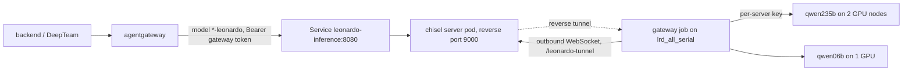

# Leonardo inference

Open-weight models served with vLLM on CINECA's Leonardo (Slurm, Singularity, A100 64 GB), behind an
OpenAI-compatible API with a per-run key. Built by Junghwa ([@Jules0315](https://github.com/Jules0315)) on
top of the team's starter kit; copied and consolidated from
[Jules0315/Guardrails-vllm](https://github.com/Jules0315/Guardrails-vllm) at commit `298432c`.

| Profile | Model | Served as | Layout | Cold start | Status |
| --- | --- | --- | --- | --- | --- |
| `qwen235b` | Qwen3-235B-A22B-FP8 | `qwen3-235b-a22b-fp8-leonardo` | 2 nodes, TP4 / PP2 | 7 min | GPU-validated |
| `glm53` | GLM-5.3-Flash | `glm-5.3-flash-leonardo` | 2 nodes, TP4 / PP2 | 13 min | GPU-validated |
| `deepseek41` | DeepSeek-V4.1-Flash-1017 | `deepseek-v4.1-flash-1017-leonardo` | 2 nodes, TP8 + expert parallel | 26 min | GPU-validated |
| `qwen06b` | Qwen3-0.6B | `qwen3-0.6b-leonardo` | 1 GPU, stock vLLM 0.31.0 | | not yet run in `serve/` |

The large servers take 2 full nodes (8 GPUs) for up to 2 hours, with a 2,048-token context and 4 concurrent
sequences (DeepSeek: 2). `qwen06b` is the cheap end-to-end test and the template for one-GPU moderation
models. See [validation](#validation) for what ran on GPUs and what changed since.

## Layout

```text
cli.py        admin CLI: run everything from your laptop over your own SSH login. Start here.
serve/        what runs on Leonardo: profiles, runtime catalog, Slurm jobs, readiness checks, gateway
install/      one-time setup of runtimes, checkpoints and the tunnel client in the team folder
diagnostics/  node probe, reachability check, NCCL bandwidth check
validation/   evidence from the GPU runs and the hashes of the code that passed them
docs/         how-it-works.md (read before changing serve/), history.md
tools/, tests/  local checks and generators; no cluster needed
```

The Kubernetes side is the opt-in component [`infrastructure/leonardo/`](../infrastructure/leonardo/kustomization.yaml).

## Quick start: the admin CLI

Run it from any machine where `ssh YOUR_LOGIN@login01-ext.leonardo.cineca.it` works (Python 3.7+, no
packages). It authenticates once and reuses that SSH connection for 30 minutes. Each command uploads this
checkout's `serve/` to `~/.leonardo-inference/releases/<hash>/` on Leonardo if it is not there yet, so
Leonardo needs no Git access, and runs `serve/inference.py` there.

```bash
cd leonardo
export LEONARDO_USER=YOUR_LOGIN LEONARDO_BASE='$WORK/team_vllm'   # single quotes: expanded on Leonardo
./cli.py up qwen235b                                  # prepare + submit; prints the job id
./cli.py up qwen06b --qos boost_qos_dbg --time 00:30:00   # quick test on the debug QoS
./cli.py status                                       # your servers, your gateway, the team registry
./cli.py down qwen235b                                # or a job id; down gateway stops the gateway
```

`team_vllm` is the public placeholder. Use the team's actual folder name, which you can get from Junghwa.
Coordinate with the team: one big server at a time. Servers stop at their time limit (2 h on
`boost_qos_lprod`, 30 min on `boost_qos_dbg`); run `up` again to replace one.

### One entry point for all servers: the gateway

```bash
./cli.py gateway up --hours 12     # a small CPU job that resubmits itself for 12 hours
./cli.py tunnel                    # laptop: http://127.0.0.1:18000/v1, keep it open
./cli.py gateway token > ~/.config/leonardo-gateway-token   # the bearer token for the gateway
```

```bash
curl http://127.0.0.1:18000/v1/models -H "Authorization: Bearer $(cat ~/.config/leonardo-gateway-token)"
curl http://127.0.0.1:18000/v1/chat/completions -H "Authorization: Bearer $(cat ~/.config/leonardo-gateway-token)" \
  -H 'Content-Type: application/json' \
  -d '{"model":"qwen3-235b-a22b-fp8-leonardo","messages":[{"role":"user","content":"Hi"}],
       "chat_template_kwargs":{"enable_thinking":false}}'
```

The gateway routes by the `model` field to whichever of **your** servers is ready, and swaps the gateway
token for that server's own key. It runs on the CPU-only `lrd_all_serial` queue, which has a 4-hour limit,
so each job queues its successor with `--dependency=singleton`. Expect a short gap at each hand-over. It
only sees servers started by the same login, because it reads their keys from your private run
directories.

## Connect the cluster (prepared, off until the organisers approve)

The cluster never logs in to Leonardo. The gateway job dials **out** with
[chisel](https://github.com/jpillora/chisel) to a chisel server in GKE and opens one reverse port there.
agentgateway sends Leonardo model names to that port through the `leonardo-inference` Service:



The outbound route needs the organisers' explicit OK, because the terms forbid working around security
controls. Two open questions decide where it can run; `diagnostics/reach.sbatch` answers both:
can `lrd_all_serial` nodes reach GPU-node ports, and can they reach the internet (directly or through the
hackathon proxy on login node 7)? Once approved:

1. **Secrets in GKE** (once):

   ```bash
   SERVER_KEY=$(docker run --rm jpillora/chisel:1.13.0 server --keygen -)   # or the chisel binary
   TUNNEL_PASSWORD=$(openssl rand -hex 24)
   kubectl create secret generic leonardo-tunnel --from-literal=server.key="$SERVER_KEY" \
     --from-literal=users.json="{\"leonardo:$TUNNEL_PASSWORD\": [\"^R:0.0.0.0:9000\$\"]}"
   ./cli.py gateway token | kubectl create secret generic leonardo-gateway --from-file=token=/dev/stdin
   ```

   The `users.json` entry lets that user open only the one reverse port.
2. **Enable the component**: add `components: [../leonardo]` to `infrastructure/gke/kustomization.yaml`.
   The chisel server logs its fingerprint at start: `kubectl logs deploy/leonardo-tunnel | grep Fingerprint`.
3. **Site settings** in `$BASE/inference-site.json`, under `gateway`: `"outbound_tunnel": true`,
   `"tunnel_server": "https://european-ai-hackathon-2026.codify.ch/leonardo-tunnel"`, the fingerprint, and
   `"tunnel_proxy"` if the route needs the hackathon proxy.
4. **On Leonardo** (once): `cd install && sbatch 04_install_chisel.sbatch`, then from the laptop:

   ```bash
   printf 'leonardo:%s\n' "$TUNNEL_PASSWORD" > /tmp/tunnel_auth
   ./cli.py gateway up --restart --tunnel-auth-file /tmp/tunnel_auth && rm /tmp/tunnel_auth
   ```

The routes in agentgateway are generated: [tools/render_agentgateway.py](tools/render_agentgateway.py)
writes `infrastructure/leonardo/agentgateway.yaml` from the base config plus one route per profile, with
the same request guardrails as the default route. Re-run it after adding a profile; CI checks it is
current. The same chain (agentgateway v1.6.0, chisel 1.13.0, gateway job, stand-in vLLM) was tested end
to end on a workstation, including streaming, the single-port authfile and fingerprint pinning; it has not
run on Leonardo or GKE yet.

## Run a server by hand (on a login node)

This is what `cli.py up` does for you.

```bash
ssh YOUR_LOGIN@login01-ext.leonardo.cineca.it
git clone https://github.com/CodifyAG/european-ai-hackathon-2026.git   # once; needs a GitHub token if private
cd european-ai-hackathon-2026 && git pull --ff-only
BASE="$WORK/team_vllm" MODEL=qwen235b
RUN_DIR=$(bash leonardo/serve/prepare_run.sh "$MODEL" --base "$BASE") && cd "$RUN_DIR"
python3 inference.py cpu-check    # optional: imports the runtime's modules in the container, no GPU
bash submit_server.sh --dry-run   # shows the sbatch command; --qos/--time override for a quick test
bash submit_server.sh             # add --reservation NAME on workshop days
tail -f *-common-*.out            # wait for INFERENCE_READY
cat .runtime/endpoint.json        # node, port, model, expected end time
cat .runtime/api_key              # share privately with teammates who need it
scancel "$(cat .runtime/job_id)"  # stop it when done
```

Preparing checks every asset, makes a private copy of the code in `$HOME`, and creates a fresh API key. The
job claims the model name in the team registry when it starts, publishes the endpoint only after the API
checks pass, and withdraws it when it stops. It stops itself if the model dies, if `/health` fails 3
times, and about 90 seconds before the time limit.

## Call one server directly (client, on your laptop)

Without the gateway, you need your own Leonardo login, the operator's `endpoint.json` and that server's key:

```bash
cd leonardo/serve
MODEL=qwen235b PROFILE="profiles/$MODEL.json" KEY_FILE=".runtime/$MODEL-api-key"
python3 client.py key    --profile "$PROFILE" --key-file "$KEY_FILE"     # hidden prompt, never overwrites
python3 client.py tunnel --profile "$PROFILE" --endpoint endpoint.json --user YOUR_LOGIN   # keep open
python3 client.py test   --profile "$PROFILE" --key-file "$KEY_FILE"     # second terminal: the API checks
python3 client.py chat   --profile "$PROFILE" --key-file "$KEY_FILE"
```

`*.runtime/`, `endpoint.json` and key files are git-ignored. Keep them out of shared folders anyway.

## The team registry

With `"endpoints": "endpoints"` in the site file, every server keeps `$BASE/endpoints/<served model>.json`
(host, port, job, owner, expected end) while it is ready. Records never contain keys, because the project
account may be shared with other teams. A lock next to the record allows one server per model name: a
second job with the same name fails within seconds instead of after loading weights. A lock left by a job
that Slurm no longer knows is taken over automatically. `./cli.py status` lists the registry.

## Small models and moderation

Small models run on the stock vLLM runtime (`vllm-0.31.0` in [serve/catalog.json](serve/catalog.json)) on
one GPU. Copy `profiles/qwen06b.json` and change the model, `served_model`, `checkpoint` and `checks`:

| `checks` | Runs | For |
| --- | --- | --- |
| `chat_tools` (default) | 401, catalog, arithmetic, English, SSE, forced tool call, 4 concurrent | chat models |
| `chat` | the same without the tool call | chat models without a tool parser |
| `minimal` | 401, catalog, any completion | generative guard models such as Llama Guard |
| `classify` | 401, catalog, `/classify` returns a label | `--runner pooling` classifiers |

agentgateway routes chat-style APIs, so classifiers on `/classify` are reached through the gateway directly.

## Diagnostics

```bash
cd leonardo/diagnostics
sbatch probe.sbatch                                   # interfaces, IB, GPU; serves a page for 15 min
TARGET=lrdnXXXX:PORT PROBE_PROXY=http://... sbatch reach.sbatch   # from lrd_all_serial: GPU node? internet?
BASE=$WORK/team_vllm RUNTIME=vllm-0.31.0 sbatch nccl_check.sbatch # 2 nodes: NCCL over InfiniBand?
```

## Fresh install

The team's installation of the backport runtime and the three large checkpoints already exists. New: the
stock runtime and `qwen06b`. All jobs run on the CPU-only serial queue, which has internet. Set
`SBATCH_ACCOUNT` and `BASE` first, and submit from `install/`:

```bash
cd leonardo/install
sbatch 01_pull_runtime.sbatch vllm-0.31.0        # image from serve/catalog.json -> $BASE/staging/vllm-0.31.0
sbatch 02_install_overlay.sbatch vllm-0.31.0     # pinned extra packages (none for stock vLLM)
python3 register_runtime.py --id vllm-0.31.0 --sif "$BASE/staging/vllm-0.31.0/image.sif" \
  --overlay "$BASE/staging/vllm-0.31.0/python-overlay" --destination "$BASE/runtimes/vllm/0.31.0"
sbatch 03_download_checkpoint.sbatch qwen06b     # prints PIN_REVISION: put it into profiles/qwen06b.json
```

Then add the new runtime, checkpoint, `"endpoints"` and `"gateway"` entries from
[serve/site.example.json](serve/site.example.json) to `$BASE/inference-site.json`, and run
`mkdir -p "$BASE/users"` if it does not exist. For the large profiles the runtime is
`vllm-backport-sm80-0.13.1` (destination `runtimes/vllm-backport-sm80/0.13.1`); its overlay step installs
the pinned TileLang wheel. These scripts are generalised from the original GLM and Qwen preparation jobs and
have not been re-run in this exact form.

## Add a model

1. Add a profile in `serve/profiles/` ([docs/how-it-works.md](docs/how-it-works.md#profiles) lists the
   rules), download it with `install/03_download_checkpoint.sbatch <profile>`, and add its checkpoint to
   `$BASE/inference-site.json`.
2. Run `python3 tools/update_manifest.py` and `python3 tools/render_agentgateway.py`.
3. Run it once on the debug QoS and record the result in `validation/`.

## Local checks

```bash
cd leonardo
python3 tools/check_repository.py              # syntax, manifest, agentgateway config, links, drift
python3 -m unittest discover -s tests          # simulated Slurm, container, SSH and HTTP
```

These run in CI, together with a Python 3.6 compatibility check (`vermin`) for what runs on the login
nodes. They test orchestration, not GPU kernels or model quality.

## Validation

[validation/validated_code.json](validation/validated_code.json) lists the exact `serve/` bytes that ran on
GPUs. The unified version changes `inference.py`, `lifecycle.py`, `node.py` and `test_endpoint.py`, and adds
the gateway, registry and catalog; `check_repository.py` lists all of them. The model profiles and the
container command are unchanged. Before relying on it, run on the debug QoS and record the new hashes:

```bash
./cli.py up qwen06b --qos boost_qos_dbg --time 00:30:00    # after the fresh-install steps above
./cli.py up qwen235b --qos boost_qos_dbg --time 00:30:00   # 7 min cold start
./cli.py gateway up --hours 1 && ./cli.py tunnel           # then curl through 127.0.0.1:18000
```

Every earlier run used one operator account; other accounts, sustained load and unattended operation are
untested. Details are in [docs/history.md](docs/history.md).
