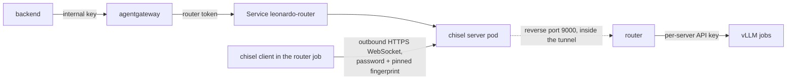

# The cluster link: design and alternatives

The app's agentgateway runs in GKE; the models run in Slurm jobs on Leonardo. This page explains how the
two are connected, why this way, and what is known to work. The cluster-side setup is in
[infrastructure/leonardo/README.md](../../infrastructure/leonardo/README.md); the router itself is
described in [how-it-works.md](how-it-works.md#the-router).

## Constraints

- GPU nodes accept no connections from outside Leonardo and have no internet. Login nodes and the CPU
  queue `lrd_all_serial` do reach the internet (the install jobs download from Hugging Face there), and
  they reach ports on GPU nodes (the router does this today).
- Leonardo logins are personal and must not be shared, so nothing in the cluster may hold a login and SSH
  in. CINECA's terms also forbid working around security controls, so the organisers approve the
  connection before it is switched on.
- Model jobs come and go (2-hour limit), and so does the router job (renewed every 4 hours).

So the connection has to be opened from Leonardo, by a job, and it has to survive both sides restarting.

## Design

- The router job starts a [chisel](https://github.com/jpillora/chisel) client next to the router. It
  connects out to `https://<app host>/leonardo-link`, a path on the app's existing Ingress and certificate,
  and asks the server to listen on port 9000 and forward that port back to the router.
- The client checks the server's key fingerprint before sending its password, so a wrong server (or a
  proxy in between) learns nothing. The server accepts one user, and that user may open only
  `R:0.0.0.0:9000` (`users.json`).
- Port 9000 is reachable only inside the cluster, through the `leonardo-router` Service. The public path
  speaks only the chisel protocol; a plain request gets `404`.
- Three keys stay separate: the app's internal key ends at agentgateway; agentgateway sends the router
  token, which ends at the router; the router sends each model server its own key. None of them crosses
  the public internet unencrypted, and the link password never appears on a command line.
- chisel retries by itself (at most every 30 s, `--max-retry-interval`). The router reads its log and
  restarts it if the process ever exits. The state is shown by `cli.py status` and `GET /health`:

  | State | Meaning |
  | --- | --- |
  | `connecting` | The client was started and has not got through yet. |
  | `connected` | The tunnel is up; agentgateway can reach the router. |
  | `retrying` | The connection was lost or refused; chisel keeps trying. The error says why, for example `dial tcp …: connection refused`, `Invalid fingerprint`, `unable to authenticate`, or `Server cannot listen on R:9000` (another router holds the port). |
  | `restarting` | The client process exited; the router starts it again after a pause (5 s, growing to 5 min). |

- When the link or the router is down, agentgateway answers `503` at once; when a model's server is not
  running, the router answers `404 model_not_found`.

## Alternatives considered

| Option | Why not (for now) |
| --- | --- |
| SSH from the cluster to Leonardo (`ssh -L`) | Needs a personal Leonardo login stored in the cluster. Not allowed. |
| SSH reverse tunnel from Leonardo (`ssh -R`) | Same direction as chisel, but needs an SSH server in the cluster on a TCP load balancer and outbound port 22; chisel reuses the existing HTTPS Ingress, certificate and port 443, and passes HTTP proxies. |
| frp, rathole, bore | Same idea as chisel. frp and rathole need more configuration and, without extra modes, their own TCP port; bore has no encryption. Nothing they add is needed here. |
| Tailscale, WireGuard, Nebula | A full network for one HTTP port. Needs a TUN device or userspace networking on Leonardo, and an account with a coordination service (Tailscale); WireGuard's UDP is unlikely to pass. |
| Cloudflare Tunnel, ngrok | Puts a third party in the data path of every prompt and answer, and needs accounts there. |
| The router polls a queue in the cluster | No tunnel at all, only outbound HTTPS requests. Needs new code on both sides, and streaming becomes harder. The fallback if long-lived WebSocket connections from Leonardo turn out not to be allowed. |

## What is known

| Question | Status |
| --- | --- |
| Can the router's CPU queue reach GPU-node ports? | Yes: the router serves models today (20 Oct). |
| Does that queue have outbound internet? | Yes: install jobs download there. |
| Does the whole chain work (agentgateway, routes, guardrails, Services, chisel, router)? | Yes, in a local k3s cluster with this repository's manifests: [tests/cluster_link_poc](../tests/cluster_link_poc/run.sh). |
| Does the GCE load balancer pass the WebSocket through the Ingress? | Not tested. Check with the `curl` in the cluster README (expects `101`). |
| Can Leonardo's CPU queue reach that URL? | Yes, directly, without a proxy (`diagnose reach`, job 61614655, 21 Oct: the app's frontend answered, since the link server is not deployed yet). Once it is, the same check should report `101`. |
| Do the organisers allow it? | Open. The link stays off until they do. |
