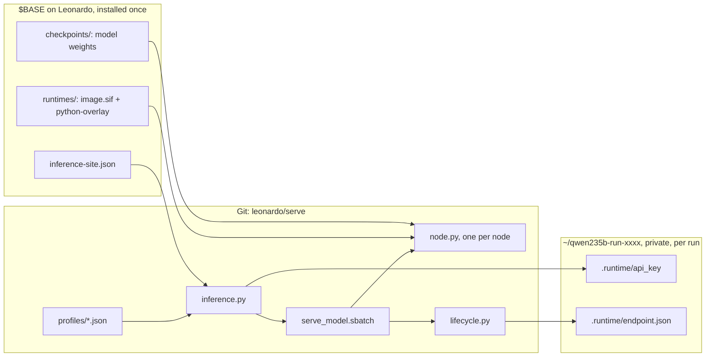

# How the serve framework works

`serve/` is one model-neutral launcher. A model is just a JSON profile; container images, weights and
secrets live outside Git. This page explains what happens between `prepare_run.sh` and a working API, and
how the gateway connects those APIs to the cluster, so you can change things without breaking them.

## Three layers



| Layer | Where | Who writes it |
| --- | --- | --- |
| Code and profiles | `leonardo/serve/` in this repo, cloned on Leonardo or uploaded by `cli.py` to `~/.leonardo-inference/releases/<hash>/` | Git |
| Assets: runtime image, Python overlay, weights, site config | `$BASE` (the team folder under `$WORK`) | Installed once with `install/` |
| Run state: copied code, API key, job id, endpoint, evidence | `~/<model>-run-<random>/`, mode 700 | `prepare_run.sh`, then the job |
| Per-user caches (Triton, TileLang, vLLM, HF) | `$BASE/users/<login>/<profile>--<runtime>/` | Each user's own jobs |
| Team registry: address-only records and one lock per model name | `$BASE/endpoints/` | Each server job |
| Gateway: code copy, token, job state | `~/.leonardo-inference/`, mode 700 | `inference.py gateway-up`, then the job |

## A server run, step by step

1. **Prepare** (`prepare_run.sh <profile> --base $BASE`, login node, no job yet). `inference.py prepare`
   checks the release manifest, validates the profile, reads `inference-site.json`, resolves the runtime
   and checkpoint, and checks that every shard (or the single `model.safetensors` of a small model) and
   every overlay file the runtime's catalog entry requires exists and is non-empty. It then copies the manifest's files
   into a fresh private directory in `$HOME`, writes a new random API key to `.runtime/api_key`, writes
   `RUN_CONFIG.json` with every resolved path, and prints only the run path. The key is never printed.
2. **Submit** (`submit_server.sh`, from the run directory). Builds the `sbatch` command from the profile:
   nodes, GPUs, memory, time, plus the account, partition and QoS from the site file. `SBATCH_ACCOUNT`
   overrides the account; `--qos` and `--time` override the QoS and time limit. A run can be submitted
   once; the next server needs a new prepare. `inference.py up` does prepare and submit in one step.
3. **Job start** (`serve_model.sbatch` on the first node). Re-runs the preflight, then derives ports from
   the job id: distributed master `29000 + id % 1000`, API `31000 + id % 10000`. The ranges never overlap,
   which a test checks for all 10,000 suffixes. It `srun`s `node.py` once per node.
4. **Per node** (`node.py`). Builds a `singularity exec --nv --cleanenv --no-home --contain` command with
   explicit read-only binds for the runtime and checkpoint, writable binds for the private cache, and
   `/dev/infiniband`. Rank 0 runs `vllm serve ... --host 0.0.0.0 --port <api>`; other ranks run
   `--headless` and find rank 0 through `--master-addr`. No Ray. One-node profiles get no
   `--nnodes`/`--master-*` flags at all. Profiles can request two vetted hooks
   first: `nccl_ep`, an 8-GPU collective smoke test for expert parallelism, and `warm_engram`, which
   pre-reads DeepSeek's Engram rows into the page cache.
5. **Readiness gate** (`lifecycle.py`). First claims the served model name in the team registry, if the
   site has one; a second live server with the same name makes the job fail here, seconds after start.
   Then polls `/health` until the profile's `startup_timeout_seconds`, and runs `test_endpoint.py` with the
   profile's check suite. The default `chat_tools` suite is 401 without a key, model catalog, exact
   arithmetic, an English answer, SSE streaming with `[DONE]`, a forced tool call with JSON arguments, and
   four concurrent requests. Only if every check of the suite passes does it write
   `.runtime/endpoint.json`, publish the address-only registry record and print `INFERENCE_READY`.
6. **Watchdog**. Every 5 s, if the launcher dies or `/health` fails 3 times in a row, the job exits and the
   private endpoint, the registry record and the claim are removed. Slurm sends TERM 90 s before the wall
   clock (`--signal=B:TERM@90`).

## Why it is built this way

- **GPU nodes have no internet.** Everything is downloaded beforehand on `lrd_all_serial`, and the container
  runs with `HF_HUB_OFFLINE=1`.
- **Every Leonardo user can reach any port on a compute node.** vLLM must listen on `0.0.0.0` so the login
  node can forward to it, so each run gets its own API key, and run directories are private.
- **A100s are SM80.** Stock vLLM has no usable sparse-MLA backend for GLM on A100 and no native FP8. The
  shared runtime is a community SM80 backport (vLLM 0.13.1), plus the official TileLang 0.1.12 wheel in a
  Python overlay because the image's copy is incomplete. FP8 checkpoints run with weight-only Marlin kernels.
- **Host driver is 535 (CUDA 12.2).** `VLLM_ENABLE_CUDA_COMPATIBILITY=1` loads the image's forward-compat libs.
- **Lustre is slow for random reads.** Profiles use `--safetensors-load-strategy eager` (or `lazy` for
  DeepSeek) to read shards sequentially.
- **Unix socket paths have a length limit.** The runtime temp dir is bound to the short `/tmp/inference-tmp`.
- **The login nodes run Python 3.6.8.** `serve/` and `tools/` use only the standard library and 3.6 syntax.

## The gateway

`gateway.py` runs as its own small job (`gateway.sbatch`, default `lrd_all_serial`, 2 CPUs, 4 h) and
listens on `41000 + job id % 10000`. It is the only process that holds server keys on behalf of others:

- **Discovery** from private state only. Every 10 s it scans `~/*-run-*/` for runs that are mode 700 and
  owned by the same account, have a `.runtime/endpoint.json`, and whose job `squeue` still lists. The
  shared registry is never trusted for routing, because anyone in the project group can write to it.
- **Routing** by the JSON `model` field of each POST to that server, with `Authorization` replaced by the
  server's own key. `GET /v1/models` lists the routable models; `GET /health` needs no token.
- **Authentication** with one bearer token in `~/.leonardo-inference/gateway_token` (compared in constant
  time). The cluster holds the same token in the `leonardo-gateway` Secret.
- **Streaming**: responses are relayed as they arrive (`read1`), so SSE is not buffered.
- **Chaining**: each job first queues its successor with `--dependency=singleton` until the `--hours` given
  to `gateway-up` run out. `down gateway` cancels all jobs named `leonardo-gateway`, pending ones included.
- **Outbound tunnel** only when the site sets `"outbound_tunnel": true`. Then `gateway-up` copies the chisel
  binary from `$BASE/tools/` after checking its SHA-256 against `catalog.json`, and the job runs
  `chisel client --fingerprint <pinned> <tunnel_server> R:0.0.0.0:<tunnel_remote_port>:127.0.0.1:<port>`
  with the password from `~/.leonardo-inference/tunnel_auth` in its environment (not on the command line).

Ports by job id, so jobs on a shared node do not collide: distributed master `29000-29999` (+1 for the EP
hook), model API `31000-40999`, gateway `41000-50999`.

## Runtimes

`serve/catalog.json` lists every runtime a profile may name: the image (pinned by digest), the pinned
packages for its Python overlay, the overlay files `prepare` must find, and the modules `cpu-check`
imports. `vllm-backport-sm80-0.13.1` needs TileLang in its overlay; stock `vllm-0.31.0` needs nothing. The
install scripts read the same file, so a new runtime is one catalog entry plus `install/01`, `02` and
`register_runtime.py`.

## Profiles

`inference.py profile_check` enforces the rules, so a bad profile fails at prepare time, not after a
30-minute queue:

- `tensor × pipeline` must equal `nodes × gpus_per_node`.
- `engine_args` may not set anything the launcher manages: ports, host, parallelism, node rank, master
  address, API key or `--config`.
- `environment` may not override `VLLM_API_KEY`, `PYTHONPATH`, `CUDA_VISIBLE_DEVICES`, `HF_HOME`,
  `TMPDIR` or `VLLM_HOST_IP`.
- `hooks` must come from the allowlist (`nccl_ep`, `warm_engram`).
- `runtime` must be in `catalog.json`; `checks`, if set, must name a suite in `inference.CHECK_SUITES`.
- `client.chat_template_kwargs` are sent with every test and client request. Qwen uses
  `enable_thinking: false`, so the tests see final answers instead of reasoning only.

## The release manifest

`serve/RELEASE_MANIFEST.json` lists every file in `serve/` with its SHA-256. `prepare` refuses to run if
anything differs, and copies exactly those files into the run directory. This protects a shared checkout
on Leonardo from silent edits. After changing anything in `serve/`, run:

```bash
python3 tools/update_manifest.py
```

`validation/validated_code.json` separately records the bytes that passed real GPU runs.
`tools/check_repository.py` tells you when `serve/` has drifted from them.

## Shared layout under `$BASE`

```text
inference-site.json                    account, partition, QoS, runtime and checkpoint paths, gateway settings
runtimes/vllm-backport-sm80/0.13.1/    image.sif, python-overlay/, runtime.json (hashes)
runtimes/vllm/0.31.0/                  stock vLLM, empty overlay
checkpoints/{qwen235b,glm53,deepseek41,qwen06b}/
endpoints/                             registry: <served model>.json and .<name>.lock/, group-writable
tools/chisel-1.13.0                    tunnel client, only with the outbound tunnel
users/<login>/<profile>--<runtime>/    private caches, created on first prepare
staging/, wheels/, cache/              install-time only
```

The site operator creates `users/` and grants teammates read access to `runtimes/` and `checkpoints/`.
`register_runtime.py` hardlinks the SIF when it can, so registration does not store the image twice.
Never modify a hardlinked SIF in place.
